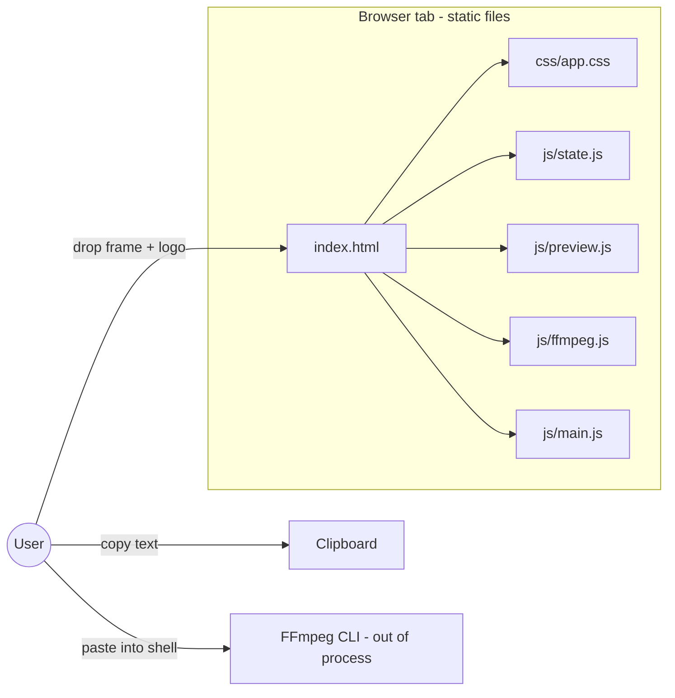
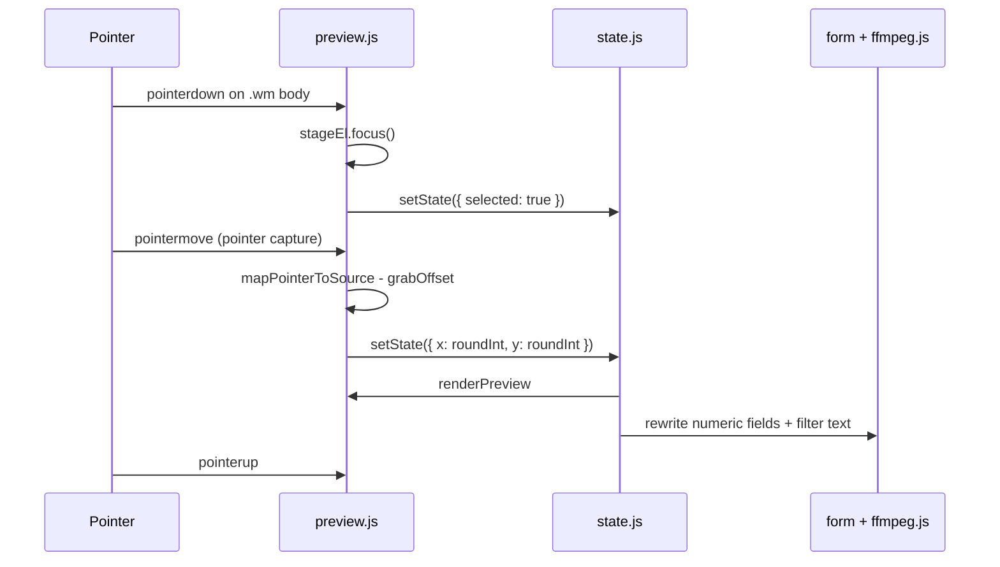
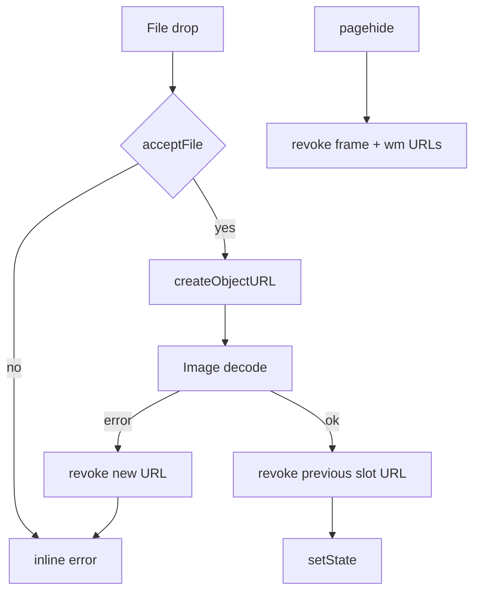

# FFmpeg Watermark Placement Prototype

| Field | Value |
| --- | --- |
| **Title** | FFmpeg Watermark Placement Prototype (local static web tool) |
| **Author** | a5ah1 |
| **Date** | 2026-08-16 |
| **Status** | v1 spec (implemented) + libx264 command slice (audio, metadata) |
| **Audience** | Local user; future implementer |
| **Workspace** | This repository |

---

## Overview

Placing an image watermark with FFmpeg is easy to type and easy to get slightly wrong: `overlay=x:y` is top-left in source pixels, scale is easy to mismatch with the preview in your head, and opacity is a separate `format=rgba,colorchannelmixer=aa=` chain rather than an `overlay` option. This prototype is a **local, static, no-backend page** that lets the user drop a representative video frame and a watermark image, drag/resize the watermark visually, and copy a correct `-filter_complex` string plus a full libx264 CRF command (audio + optional metadata).

Working notes and landmines for later changes live in [AGENTS.md](AGENTS.md). This file is the v1 contract (goldens, module surface, UI ids).

The tool **never runs FFmpeg**, never uploads files, and never needs npm, a bundler, or FFmpeg.wasm. It is static HTML/CSS plus classic (non-module) scripts that work from `file://` or any trivial static server. All geometry is computed in **source pixels of the main frame**; the preview is only a letterboxed view of that space. Generated graphs use named overlay options, integer `x/y/w/h`, and omit `scale` / `colorchannelmixer` when they would be no-ops.

**Normal / `overlay` is the hero encode path** and the only one that is a short, still-as-secondary graph. Curated Photoshop-style modes stay in v1 only because they are specified as frozen, framesync-correct strings (video drives duration on every dual-input filter; stills are looped *inside* the graph). A CSS `mix-blend-mode` preview is an approximation, not a proof.

---

## Background & Motivation

### Current state

Implemented: placement desk + frozen blend goldens + encode modal (libx264 CRF, audio copy/omit/aac/libfdk, metadata). No component library, no FFmpeg.wasm. Encode-flag conventions were taken from [ffmpeg.party’s x264 wizard](https://ffmpeg.party/tools/x264-wizard/); that repo is not a dependency. The user already has FFmpeg CLI and wants a filter they would have written by hand, plus a runnable command.

### Pain points

1. **Coordinates are source pixels, previews are CSS pixels.** Guessing `x=1680:y=980` on a 1920×1080 timeline from a windowed screenshot is slow.
2. **Opacity is not an overlay flag.** The well-supported path is `[1:v]format=rgba,colorchannelmixer=aa=0.8[wm]` before overlay. Easy to forget `format=rgba` (JPEGs have no alpha).
3. **`overlay` is alpha compositing only.** Photoshop-style multiply/screen require `blend`, which demands same-size inputs. A naïve full-frame `pad`+`blend` on transparent black **multiplies the whole frame by zero** in the padded region, and putting the still first on `blend` **freezes frame 0** under the logo (`repeatlast` only extends *secondary* inputs). The generator must not emit either trap.
4. **The HTML File API never yields a full filesystem path** (`File.name` is the basename). Command generation therefore needs editable text fields the user can paste `C:\media\logo.png` into.
5. **FFmpeg.wasm / a backend** would let us run the encode in-page, but that is out of scope: the user already has FFmpeg CLI; they want a placement calculator.

### Verified FFmpeg facts this design is bound to

Official reference: [https://ffmpeg.org/ffmpeg-filters.html](https://ffmpeg.org/ffmpeg-filters.html) (and the Color section of [ffmpeg-utils](https://ffmpeg.org/ffmpeg-utils.html#color-syntax)).

**`overlay` (11.188).** Two inputs, one output. First = main, second = overlay. `x`/`y` are expressions for the overlay's top-left on main (default `0`). Invalid expression → huge off-screen value. Vars: `main_w`/`W`, `main_h`/`H`, `overlay_w`/`w`, `overlay_h`/`h`, `x`, `y`, `hsub`, `vsub`, `n`, `t`. `eval` is `init` or `frame` (default `frame`). `format`: `yuv420` (default), `yuv420p10`, `yuv422`, `yuv422p10`, `yuv444`, `yuv444p10`, `rgb`, `gbrp`, `auto`. `alpha`: `straight` | `premultiplied` | `auto` (current ffmpeg.org default is `auto`; we do not emit `alpha=`). Framesync: `eof_action` default **repeat**, `repeatlast` default `1`, `shortest` default `0`. A still-image second input is a 1-frame stream; `repeatlast=1` holds it for the whole video — **prefer this over `-loop 1`** (which needs `-shortest` and can hang). Official examples:

```
ffmpeg -i input -i logo -filter_complex 'overlay=10:main_h-overlay_h-10' output
overlay=main_w-overlay_w-10:main_h-overlay_h-10
```

**Opacity.** Convert to rgba, then multiply existing alpha:

```
[1:v]format=rgba,colorchannelmixer=aa=0.8[wm]
```

`colorchannelmixer` `aa` is the output-alpha contribution of input alpha, range `[-2.0, 2.0]`. This multiplies PNG alpha, which is what we want. Preview uses CSS `opacity` with the same 0–1 factor.

**`scale`.** `scale=W:H` with integer pixels from `natural * scale` is the honest mapping of a drag-resize UI. Historical `scale2ref` is now `scale` with `rw`/`rh`; useful for “20% of video height”, **not** the v1 model. `setsar=1` is an anamorphic edge case only — do not emit it by default.

**`blend` (11.14).** Overlay has **no** Photoshop blend modes. `blend` takes two **same-size** frames; **first input = top, second = bottom**. Framesync (§7): `repeatlast` (default 1) extends the last frame of **secondary** streams until the end of the **primary** stream. Default `blend` output ends when the *longest* input ends. Therefore a 1-frame still as blend **primary** (required so the watermark stays **top** — `all_mode=overlay` is not commutative; other curated modes are, but we keep one watermark-first graph) emits **one frame** unless that still is looped inside the graph and `shortest=1` makes the finite video end the filter. Curated modes for v1: `multiply`, `screen`, `overlay`, `addition`, `darken`, `lighten` (plus UI `normal`, which stays on the overlay path). `all_opacity` exists but we do opacity via `colorchannelmixer` so PNG alpha is preserved. CSS `mix-blend-mode` approximates the preview and is **not pixel-identical**.

**`loop` (11.152).** `loop=loop=-1:size=1` repeats the current 1-frame buffer forever **inside the graph**. This is not CLI `-loop 1` on an input (which requires `-shortest` and can hang the whole process). Use `loop` only on still chains in the blend path, always paired with `shortest=1` on `blend`.

**`split`.** Explicit `[0:v]split[base][bot]`. Do not rely on the ffmpeg CLI auto-inserting a split when a labeled pad is read twice; labeled graphs and older builds do not.

**`alphaextract` / `alphamerge` (11.2 / 11.3).** `alphaextract` emits grayscale from alpha. `alphamerge` replaces the first input's alpha with the second (grayscale) input. Official 11.3 text does not document framesync; we loop the 1-frame mask so a mask sample exists for every blended video frame.

**`pad` (not used in the emitted v1 graphs).** Official pad **re-centers** when `x` or `y` is negative and errors if the input does not fit the padded box. That is why the blend path **crops both patches to the frame intersection** instead of padding the logo to full frame. `color=black@0` remains valid official Color syntax (name + `@` + 0.0–1.0 alpha) if a later revision brings pad back. Overlay itself **does** clip off-frame placement, so the default path can emit negative `x`/`y`.

**`crop`.** `crop=W:H:X:Y` on chroma-subsampled video (yuv420p) **rounds W/H/X/Y down to even** unless `exact=1`. A 55-wide still stays 55 after `scale` / `format=rgba`; the video patch becomes 54 and `blend` errors (`top parameters (size 55×H) do not match … bottom parameters (size 54×H)`). The watermark crop runs after `format=rgba`, so it is already exact. The video `[bot]` crop is not — always emit `:exact=1` on that crop (named option after positional `W:H:X:Y`, same pattern as `overlay=…:format=auto`). Do not convert the full frame to `gbrp` before crop. Overlay/normal never crops `[0:v]`, so it does not hit this.

**Inputs.** Prefer separate `-i` over `movie=`. Filenames belong on `-i`, never inside the graph.

**Escaping.** Three levels: option values (`:`), filtergraph (`[],;`), then the shell. Named options (`overlay=x=10:y=20:format=auto`) avoid the characters we would otherwise escape.

---

## Goals & Non-Goals

### Goals (v1)

- Load one **main frame** still and one **watermark** still via drag-and-drop or file input.
- Treat the frame's `naturalWidth × naturalHeight` as the video size for the session.
- Drag, aspect-locked resize, opacity, 9-point snap presets, and keyboard nudge in source pixels.
- Bidirectional UI: pointer ↔ numeric fields.
- Generate a copyable `filter_complex` string (hero) and a full `ffmpeg` command (secondary) with libx264 CRF, optional AAC, and optional metadata.
- Optional curated blend modes, only with the frozen framesync-correct graph specified below.
- Work as static files: `index.html` + `css/app.css` + `js/*.js`. No build step.
- Open from `file://` or a one-line static server.
- Remember this tab’s fields and images in `sessionStorage` until the tab is closed or Reset.
- Small local tests for pure functions.

### Non-goals (explicitly out of v1)

- Running FFmpeg, FFmpeg.wasm, encoding, or uploading anything.
- Backend, npm, bundler, TypeScript, framework, service worker, `localStorage`, or cross-tab persistence. Tab `sessionStorage` is in v1 (lost on close).
- Video files as the “main frame” (frame is a still). Animated watermark / animated GIF as a video stream.
- SVG (FFmpeg does not reliably consume it).
- Rotation, non-uniform stretch, multiple watermarks, `drawtext`, `enable=` timelines.
- Clamping the watermark inside the frame (overflow is allowed; FFmpeg clips).
- Pixel-identical blend-mode preview.
- BMP (optional in the brief; dropped so the toast, `accept`, and README stay one list).
- Telemetry, accounts, feature flags, CI-as-a-platform.

---

## Key Decisions

1. **Hero output is the filter graph; the full command is secondary and always visible.** The user already has an encode pipeline. They need `filter_complex` more often than a whole command. Placeholders `INPUT_VIDEO` / `WATERMARK` / `OUTPUT` fill empty filename fields so the command is always a valid template. Encode quality lives in a modal; `#command-out` stays on the page and live-updates. Rationale: one copy target that is always right; command is a convenience, not a second mode.

2. **Vanilla classic scripts on `window.WM`, not ES modules.** Chrome blocks ES modules on `file://`. Classic `<script src>` works from disk and from a static server, and the test page can load the same files. Rationale: zero-friction open.

3. **Source-pixel coordinate space, integer `x`, `y`, `scaledW`, `scaledH`.** Preview letterboxes into `#stage`. Default **1:1** never upscales (`viewScale = min(1, contain)`); **Fit** is unconstrained contain. Mapping uses the computed contain-rect (`naturalWidth/Height` vs stage `getBoundingClientRect()`), **not** the `` box (the box is the stage; the painted image is smaller). `viewMode` is live-only and is not written to `sessionStorage`. Rationale: FFmpeg never sees CSS pixels; small clips should stay native-size unless the user asks to fill the stage.

4. **Uniform scale factor (3 decimal places, range 0.01–8.00) + derived integer size.** No independent W/H stretch. `scale` is omitted from the graph iff `scale === 1` **and** rounded W×H equal native W×H. Rationale: drag-resize UIs that unlock aspect produce filters nobody wanted.

5. **Default placement: bottom-right, 24 source-px margin; auto-scale-down-to-fit if native size exceeds the frame minus margins; otherwise center if it still cannot sit on BR.** Rationale: the official overlay example is BR-with-margin; 24 px is visible on 1080p and 4K without looking glued to the edge.

6. **Overflow is allowed.** Overlay path emits negative or past-the-edge integers; FFmpeg clips. No clamp-inside control in v1. Blend path never calls `pad`; it crops both the scaled watermark and the video to the same intersection rectangle (`intersectCrop`) and `overlay`s the blended patch back at `(outX, outY)`.

7. **`overlay` + `format=auto` is the default pipeline and the only *guaranteed-correct* short encode.** We do **not** emit default `format=yuv420` (chroma-subsampled composite, even-x/y pressure). Trailing `,format=yuv420p` is an encode-time concern, not part of the copied filter.

8. **Opacity default 80% (`aa=0.8`).** On the overlay path, omit `colorchannelmixer` and the preceding `format=rgba` when opacity is exactly `1`. Always insert `format=rgba` before `aa=` so JPEGs gain an alpha channel. On the blend path, `format=rgba` is **always** emitted (so `alphaextract` sees a plane) even when opacity is 1.

9. **Blend modes stay in v1 as an advanced, fully specified path — not the hero.** `normal` → overlay path (still as overlay *secondary*; `repeatlast=1` is sufficient). Any other mode → the crop-patch graph in “Blend path” below, with three frozen golden strings the tests assert **byte-for-byte**. Spatially we do **not** `pad` the logo to the full frame (transparent-black pad would crush `multiply`). Temporally we do **not** feed a 1-frame still as `blend` primary without looping it. Rationale: keep the product’s curated modes, but only with a graph an engineer can implement without invention.

10. **Overlay path: still-image second input, no CLI `-loop 1`.** `repeatlast=1` holds the logo for the whole video. This framesync shape applies to **`overlay` only**. It does **not** apply to `blend` when the watermark must be the first/top input.

11. **Filenames never enter the filtergraph.** They appear only as quoted `-i` / output args. `"` in paths is escaped as `\"`. The second `-i` reads top-level `wmName`, never a nested `watermark.name`.

12. **Object URLs are revoked on replace and on `pagehide` only.** Do not register `beforeunload` and do not set `returnValue` (that prompts on tab close).

13. **No FFmpeg.wasm, no backend.** Rejected alternatives; see below.

14. **Tests are a node-free `js/ffmpeg.test.html`** asserting pure functions. Prototype-scale, no test runner. It loads **only** `state.js` + `ffmpeg.js`.

15. **On every dual-input filter in the blend path, the video is the duration driver.** `[0:v]` is consumed only through an explicit `split[base][bot]`. Stills (RGB patch and alpha mask) are looped *inside* the graph with `loop=loop=-1:size=1`. `blend` keeps the watermark as **first/top** and sets `shortest=1` so the finite video ends the filter. Never use input `-loop 1`.

---

## Proposed Design

### Runtime topology



The `S / F / P / M` chain in `index.html` is **script load order**, not a data-flow dependency. `ffmpeg.js` and `preview.js` both call `state.js` helpers; `main.js` wires them. Nothing in this repo talks to the network. The page reads local `File` objects, draws them via `blob:` URLs, and writes strings.

### File layout

```
.
  index.html
  favicon.ico          # root copy so /favicon.ico resolves
  site.webmanifest
  images/              # favicon / apple-touch / OG
  css/app.css
  js/state.js          # store + all pure geometry (including contain mapping)
  js/preview.js        # stage DOM, drag/resize; calls WM.getContainedRect / mapPointerToSource
  js/ffmpeg.js         # filter + command generation (DOM-free)
  js/modal.js          # one <dialog>; encode + help panels
  js/main.js           # wiring, file load, form, clipboard, keyboard
  js/ffmpeg.test.html  # assert page; loads state.js + ffmpeg.js only
  README.md
  LICENSE
  docs/notes.md        # command details, blend smoke test, debug
  DESIGN.md
  AGENTS.md
```

`index.html` load order:

```html
<script src="js/state.js"></script>
<script src="js/ffmpeg.js"></script>
<script src="js/preview.js"></script>
<script src="js/modal.js"></script>
<script src="js/main.js"></script>
```

`js/ffmpeg.test.html` loads **only**:

```html
<script src="js/state.js"></script>
<script src="js/ffmpeg.js"></script>
```

There is no `data-page="test"` branch and no `init` no-op. Preview/main scripts are simply not included on the test page.

### Global namespace contract

Every script attaches to `window.WM` (create if missing). No ES `export`. Functions below are the implementer's public surface — keep them stable so tests and the UI do not drift.

### State shape

```js
// window.WM.createInitialState()
{
  frame: null,
  // frame: { width: number, height: number, objectUrl: string }
  // replaced wholesale by the loader; never merge a partial

  watermark: null,
  // watermark: { nativeWidth: number, nativeHeight: number, objectUrl: string }
  // replaced wholesale by the loader; never merge a partial

  frameName: "",     // seeded from File.name; user-editable label only; NOT used by computeCommand
  wmName: "",        // seeded from File.name; user-editable; second -i path
  x: 0,              // integer source px, watermark top-left
  y: 0,              // integer source px
  scale: 1,          // uniform, 1 = native; stored rounded to 3 decimals
  opacity: 0.8,      // 0–1
  blend: "normal",   // see WM.BLENDS[].id
  videoName: "",     // editable; first -i; may be empty → INPUT_VIDEO
  outputName: "",    // editable; may be empty → OUTPUT
  encode: {          // replaced wholesale (or via WM.patchEncode); never merge a partial
    crf: 23,         // integer 0–51
    preset: "medium",// ultrafast…veryslow; no placebo
    tune: "",        // "", film, animation, grain
    fpsPreset: "",   // "", "24", "25", "30", "50", "60" — not an output -r
    audio: "copy",   // "copy" | "none" | "aac" | "libfdk_aac"
    audioMode: "vbr",// "vbr" | "cbr" — used only when aac / libfdk_aac
    audioBitrate: "192k",
    audioQuality: "",// empty → codec VBR default (aac 2, libfdk 3)
    inPoint: "",     // raw text; formatTime at emit
    outPoint: "",
    stripMetadata: false,
    metaTitle: "",
    metaDescription: "",
    metaComment: "",
    metaYear: ""
  },
  selected: false,   // watermark focused for keyboard nudge
  debug: false,      // also flipped by ?debug=1
  viewMode: "actual" // "actual" | "fit"; live preview only, not persisted
}
```

Derived (never stored; compute on read):

```js
scaledW = max(1, roundInt(nativeWidth  * scale))   // 0 if no watermark
scaledH = max(1, roundInt(nativeHeight * scale))
```

Constants:

```js
WM.MARGIN = 24;
WM.SCALE_MIN = 0.01;
WM.SCALE_MAX = 8;
WM.SCALE_DECIMALS = 3;
WM.OPACITY_DEFAULT = 0.8;
WM.CRF_DEFAULT = 23;
WM.CRF_MIN = 0;
WM.CRF_MAX = 51;
WM.PRESETS = ["ultrafast","superfast","veryfast","faster","fast","medium","slow","slower","veryslow"];
WM.BLENDS = [
  { id: "normal",   label: "Normal (overlay)", css: "normal",      ffmpeg: null },
  { id: "multiply", label: "Multiply",         css: "multiply",    ffmpeg: "multiply" },
  { id: "screen",   label: "Screen",           css: "screen",      ffmpeg: "screen" },
  { id: "overlay",  label: "Overlay (blend)",  css: "overlay",     ffmpeg: "overlay" },
  { id: "addition", label: "Addition",         css: "plus-lighter",ffmpeg: "addition" },
  { id: "darken",   label: "Darken",           css: "darken",      ffmpeg: "darken" },
  { id: "lighten",  label: "Lighten",          css: "lighten",     ffmpeg: "lighten" }
];
WM.ACCEPT_EXT = [".png", ".jpg", ".jpeg", ".webp", ".gif"];
WM.ACCEPT_MIME = [
  "image/png", "image/jpeg", "image/webp", "image/gif"
];
```

v1 whitelist is PNG / JPEG / WebP / GIF only. BMP is deferred (optional in the brief; advertising it in one place and omitting it from the toast is worse than dropping it). SVG and all `video/*` types are rejected.

### Module contracts

#### `js/state.js` — store + pure geometry

```js
WM.createInitialState(): State
WM.getState(): State
WM.setState(partial: Object): State     // SHALLOW merge of top-level keys, then notify
  // Nested frame / watermark / encode must be replaced as a whole object.
  // WRONG: setState({ watermark: { nativeWidth: 10 } })  // wipes objectUrl
  // WRONG: setState({ encode: { crf: 18 } })            // wipes preset/audio
  // RIGHT: setState({ wmName: "C:\\media\\logo.png" })
  // RIGHT: setState({ watermark: { nativeWidth, nativeHeight, objectUrl } })
  // RIGHT: WM.patchEncode({ crf: 18 })
WM.patchEncode(partial: Object): State  // copy encode, apply partial, setState({ encode })
WM.createEncodeState(): Encode          // defaults above
WM.subscribe(fn: (state) => void): () => void

WM.roundInt(n: number): number          // Math.round; non-finite → 0
WM.clampScale(n: number): number        // [0.01, 8], 3 decimals
WM.clampOpacity(n: number): number      // [0, 1]
WM.clampCrf(n: number): number          // [0, 51], round; non-finite → 23
WM.normalizePreset(value: string): string  // allowlist or "medium"
WM.normalizeTune(value: string): string    // film|animation|grain or ""
WM.normalizeAudio(value: string): string   // none|aac|libfdk_aac or "copy"
WM.audioNeedsEncode(value): boolean        // aac or libfdk_aac
WM.normalizeAudioMode(value): string       // "cbr" or "vbr" (default vbr)
WM.clampAudioQuality(codec, value): number // aac 0.1–2; libfdk 1–5; empty → default
WM.scaledSize(nativeW, nativeH, scale): { w: number, h: number }

WM.normalizeViewMode(value): string     // "fit" or "actual"

WM.getContainedRect(stageWidth, stageHeight, frameW, frameH, maxScale?)
  : { left, top, width, height, viewScale }
  // viewScale = min(stageW/frameW, stageH/frameH)
  // if maxScale is a finite number > 0: viewScale = min(viewScale, maxScale)
  // omit / non-finite maxScale → unconstrained contain (Fit)
  // preview 1:1 passes maxScale=1
  // width  = frameW * viewScale
  // height = frameH * viewScale
  // left   = (stageW - width) / 2
  // top    = (stageH - height) / 2

WM.mapPointerToSource(clientX, clientY, stageRect, contained, frameW, frameH)
  : { x, y }  // source px, not rounded (caller rounds on commit)
  // x = (clientX - stageRect.left - contained.left) / contained.viewScale
  // y = (clientY - stageRect.top  - contained.top)  / contained.viewScale

WM.defaultPlacement(frameW, frameH, nativeW, nativeH, margin = 24)
  : { x, y, scale }
  // 1. scale = 1
  // 2. maxW = frameW - 2*margin, maxH = frameH - 2*margin
  // 3. if native exceeds max box and maxW>0 and maxH>0:
  //      scale = clampScale(min(maxW/nativeW, maxH/nativeH, 1))
  //    else if native exceeds the raw frame:
  //      scale = clampScale(min(frameW/nativeW, frameH/nativeH, 1))
  //      return centered
  // 4. sw/sh from scaledSize
  // 5. x = frameW - sw - margin, y = frameH - sh - margin
  // 6. if x<0 or y<0 → center: round((frame - size)/2)

WM.presetPosition(id /* TL TC TR ML C MR BL BC BR */, frameW, frameH, sw, sh, margin = 24)
  : { x, y }
  // TL: (m, m)
  // TC: (round((fw-sw)/2), m)
  // TR: (fw-sw-m, m)
  // ML: (m, round((fh-sh)/2))
  //  C: (round((fw-sw)/2), round((fh-sh)/2))
  // MR: (fw-sw-m, round((fh-sh)/2))
  // BL: (m, fh-sh-m)
  // BC: (round((fw-sw)/2), fh-sh-m)
  // BR: (fw-sw-m, fh-sh-m)
  // Integers; may be negative if sw+2m > fw (overflow allowed).

WM.acceptFile(file: { name: string, type: string }): { ok: boolean, reason?: string }
  // ok if MIME in ACCEPT_MIME OR extension in ACCEPT_EXT (case-insensitive)
  // reject empty file, SVG (image/svg+xml / .svg) even if a browser can rasterize
  // reject video/* 

WM.basename(name: string): string       // last segment after / or \
WM.revokeUrl(url: string | null): void  // revokeObjectURL only when url starts with blob:

WM.SESSION_KEY = "wm.v1"
WM.normalizeBlend(value): string        // allowlist or "normal"
WM.normalizeFpsPreset(value): string    // 24|25|30|50|60 or ""
WM.snapshotSession(state): Object       // persistable fields + sizes; no selected; no objectUrl; no viewMode
WM.stateFromSession(data, images?): State
  // images.frame / images.watermark are data-URL (or other img src) strings
  // viewMode is always "actual" after restore
```

`setState` is the only mutator and is **shallow**. `patchEncode` is the encode helper (copy + replace). Subscribers (preview + form + outputs) re-render from `getState()`. No deep reactive system. Name edits bind to `frameName` / `wmName` / `videoName` / `outputName` — never to a nested `.name`.

#### `js/ffmpeg.js` — pure generator (no `document`)

```js
WM.formatAa(opacity: number): string
  // round to 3 decimals, e.g. 0.8 ; caller omits filter when === "1"

WM.needsScale(scale, nativeW, nativeH): boolean
  // false iff clampScale(scale)===1 && scaledSize === native

WM.needsOpacity(opacity): boolean
  // false iff clampOpacity(opacity)===1

WM.needsBlend(blend): boolean
  // false iff blend==="normal" or unknown

WM.quoteArg(path: string): string
  // '"' + path.replace(/"/g, '\\"') + '"'
  // do not rewrite backslashes (Windows paths)

WM.intersectCrop(x, y, sw, sh, fw, fh)
  : null | { cropX, cropY, cropW, cropH, outX, outY }
  // intersection of watermark rect with [0,fw)×[0,fh)
  // crop* are in the *scaled watermark* pixel space
  // outX/outY are overlay x/y of the cropped patch on the frame
  // Do not emit a pad filter. This helper is crop + overlay coords only.
  // null if cropW<=0 or cropH<=0 (fully off-frame)

WM.computeFilterGraph(state): { ok: false, reason: string } | { ok: true, filter: string }

WM.formatTime(input): string
  // trim; ";" → ":"; null/undefined/"" → ""

WM.x264ParamsForFps(fps): string
  // 24→keyint=240:aq-mode=2 … 60→keyint=600:aq-mode=2; else ""

WM.encodeSummary(encode): string
  // "libx264 · CRF 23 · medium · audio copy" plus tune / N fps / -ss / -to / aac VBR / meta when set

WM.buildAudioFlags(encode): string[]
WM.buildMetadataFlags(encode): string[]

WM.computeCommand(state, filter: string): string
  // ffmpeg [-ss] [-to] -i {video} -i {wm} -filter_complex "{filter}"
  //   -c:v libx264 -crf N -preset P [-tune T] -pix_fmt yuv420p
  //   [-x264-params "{keyint}:aq-mode=2"]
  //   [audio flags] [metadata flags] {out}
  // video = videoName.trim() || "INPUT_VIDEO"
  // wm    = wmName.trim()    || "WATERMARK"
  // out   = outputName.trim() || "OUTPUT"
  // encode missing → createEncodeState() defaults
  // -ss/-to only before the video -i; times unquoted
  // audio: copy → -c:a copy; none → omit;
  //   aac CBR → -c:a aac -b:a {bitrate};
  //   aac VBR → -c:a aac -q:a {0.1–2, default 2};
  //   libfdk VBR → -c:a libfdk_aac -vbr {1–5, default 3};
  //   libfdk CBR → -c:a libfdk_aac -b:a {bitrate}
  // metadata after audio: optional -map_metadata -1 and -metadata key="value"
```

##### Overlay path (default, `blend === "normal"`)

Build a comma-chain on `[1:v]` only for filters that are needed, then overlay.

| scale ≠ 1 | opacity ≠ 1 | Emitted graph |
| --- | --- | --- |
| no | no | `[0:v][1:v]overlay=x={x}:y={y}:format=auto` |
| yes | no | `[1:v]scale={sw}:{sh}[wm];[0:v][wm]overlay=x={x}:y={y}:format=auto` |
| no | yes | `[1:v]format=rgba,colorchannelmixer=aa={aa}[wm];[0:v][wm]overlay=x={x}:y={y}:format=auto` |
| yes | yes | `[1:v]scale={sw}:{sh},format=rgba,colorchannelmixer=aa={aa}[wm];[0:v][wm]overlay=x={x}:y={y}:format=auto` |

Example (1920×1080 frame, 300×100 logo at 0.8 scale → 240×80, BR-ish, 80%):

```
[1:v]scale=240:80,format=rgba,colorchannelmixer=aa=0.8[wm];[0:v][wm]overlay=x=1680:y=980:format=auto
```

`x`/`y`/`sw`/`sh` are integers. Negative `x`/`y` are legal here.

Do **not** emit `eval=`, `repeatlast=`, `alpha=`, or a trailing `format=yuv420p`.

##### Blend path (`blend !== "normal"`)

Two constraints, both blocking if ignored:

1. **Spatial.** `blend` needs same-size inputs and does **not** mask by top-layer alpha. A full-frame `pad` of the logo with `black@0` makes the padded region RGB `0,0,0`; `all_mode=multiply` then crushes the whole frame. v1 therefore **crops both patches to the intersection** and blends only that rectangle.
2. **Temporal.** `blend` first input is **top**. The watermark must stay first because **`all_mode=overlay` is not commutative** (video-as-top is the inverse of Photoshop overlay). `multiply`, `screen`, `addition`, `darken`, and `lighten` *are* commutative; we still use one watermark-first graph for every curated mode. That makes the still the framesync **primary**. A 1-frame primary + `repeatlast` on the secondary emits **one frame**. Feeding that 1-frame `mixa` to `overlay` as secondary then stamps video frame 0 into the logo region for the rest of the clip. v1 therefore loops the stills *inside* the graph and sets `shortest=1` on `blend` so the finite video ends the filter.

If `intersectCrop` returns `null` (fully off-frame), **fall back to the overlay path** with the raw integer `x`/`y` (FFmpeg clips) and set `#status` to `Watermark is fully outside the frame; FFmpeg will clip it.`

Otherwise emit exactly this skeleton. `{wmChain}` is the watermark steps below, **joined with commas** (no trailing comma on the last step). `split` is the next filter in that same comma-chain — always write a comma between the last `{wmChain}` step and `split`. `format=rgba` is always present, so the chain is never empty.

| Step | When emitted |
| --- | --- |
| `scale={sw}:{sh}` | `needsScale` |
| `format=rgba` | **always** on the blend path (JPEG alpha; `alphaextract`) |
| `colorchannelmixer=aa={aa}` | `needsOpacity` |
| `crop={cropW}:{cropH}:{cropX}:{cropY}` | when the intersection is not the full scaled watermark (`cropX|cropY !== 0` or `cropW×cropH !== sw×sh`) |

Then the dual-input tail is **fixed** (same labels every time):

```
[1:v]{wmChain},split[wm][wmsrc];[wmsrc]alphaextract,loop=loop=-1:size=1[maskl];[wm]format=gbrp,loop=loop=-1:size=1[wmgl];[0:v]split[base][bot];[bot]crop={cropW}:{cropH}:{outX}:{outY}:exact=1,format=gbrp[botg];[wmgl][botg]blend=all_mode={mode}:shortest=1[mix];[mix][maskl]alphamerge[mixa];[base][mixa]overlay=x={outX}:y={outY}:format=auto
```

Notes the implementer must not “simplify” away:

- Watermark is **first** on `blend` (`[wmgl][botg]`, top then bottom).
- `[0:v]` is read only via `split[base][bot]`. `base` is the uncropped video for the final overlay; `bot` is the same-size crop.
- `[bot]crop` always includes `:exact=1`. Goldens A/B/C are even-sized and would not catch chroma rounding; case 24 locks an odd W. The watermark `crop` (overflow only, after `format=rgba`) does **not** take `exact=1`.
- `loop=loop=-1:size=1` is **in-graph**. The command template still has no CLI `-loop 1`.
- `shortest=1` is on `blend` only. `alphamerge` is emitted with no extra options (11.3 does not document framesync). The looped mask supplies a sample per mix frame; mix is finite because blend already ended with the video.
- Both blend inputs are `gbrp` (no alpha in the blend). Alpha is restored by `alphamerge` from the extracted mask, then `overlay` composites the patch. The cropped video region therefore takes a yuv↔gbrp round-trip — a color shift vs the overlay-only path. Documented in Risks; not hidden.
- No `pad` filter. `outX`/`outY` are overlay coordinates only (`intersectCrop`).

###### Golden string A — fully inside, scale + opacity

State: frame `1920×1080`, watermark native `300×100`, `scale=0.8` → `240×80`, `x=1680`, `y=980`, `opacity=0.8`, `blend="multiply"`. Intersection is the full scaled rect, so no watermark `crop`.

```
[1:v]scale=240:80,format=rgba,colorchannelmixer=aa=0.8,split[wm][wmsrc];[wmsrc]alphaextract,loop=loop=-1:size=1[maskl];[wm]format=gbrp,loop=loop=-1:size=1[wmgl];[0:v]split[base][bot];[bot]crop=240:80:1680:980:exact=1,format=gbrp[botg];[wmgl][botg]blend=all_mode=multiply:shortest=1[mix];[mix][maskl]alphamerge[mixa];[base][mixa]overlay=x=1680:y=980:format=auto
```

###### Golden string B — partial overflow, scale = 1, opacity ≠ 1

State: frame `1920×1080`, watermark native `100×50`, `scale=1`, `x=-10`, `y=10`, `opacity=0.8`, `blend="multiply"`. `intersectCrop` → `{ cropX:10, cropY:0, cropW:90, cropH:50, outX:0, outY:10 }`.

```
[1:v]format=rgba,colorchannelmixer=aa=0.8,crop=90:50:10:0,split[wm][wmsrc];[wmsrc]alphaextract,loop=loop=-1:size=1[maskl];[wm]format=gbrp,loop=loop=-1:size=1[wmgl];[0:v]split[base][bot];[bot]crop=90:50:0:10:exact=1,format=gbrp[botg];[wmgl][botg]blend=all_mode=multiply:shortest=1[mix];[mix][maskl]alphamerge[mixa];[base][mixa]overlay=x=0:y=10:format=auto
```

###### Golden string C — opacity = 1 still emits `format=rgba`

State: frame `1920×1080`, watermark native `240×80`, `scale=1`, `x=1680`, `y=980`, `opacity=1`, `blend="multiply"`. No `scale`, no `colorchannelmixer`, no watermark `crop`; `format=rgba` remains.

```
[1:v]format=rgba,split[wm][wmsrc];[wmsrc]alphaextract,loop=loop=-1:size=1[maskl];[wm]format=gbrp,loop=loop=-1:size=1[wmgl];[0:v]split[base][bot];[bot]crop=240:80:1680:980:exact=1,format=gbrp[botg];[wmgl][botg]blend=all_mode=multiply:shortest=1[mix];[mix][maskl]alphamerge[mixa];[base][mixa]overlay=x=1680:y=980:format=auto
```

`js/ffmpeg.test.html` asserts `computeFilterGraph(state).filter ===` each golden string (exact equality, not `contains`).

##### Command template

```
ffmpeg -i "INPUT_VIDEO" -i "logo.png" -filter_complex "[1:v]scale=240:80,format=rgba,colorchannelmixer=aa=0.8[wm];[0:v][wm]overlay=x=1680:y=980:format=auto" -c:v libx264 -crf 23 -preset medium -pix_fmt yuv420p -c:a copy "OUTPUT"
```

With trim + film + 30 fps hint + audio omitted:

```
ffmpeg -ss 1:30 -to 2:45 -i "clip.mp4" -i "logo.png" -filter_complex "…" -c:v libx264 -crf 21 -preset slow -tune film -pix_fmt yuv420p -x264-params "keyint=300:aq-mode=2" "out.mp4"
```

Rules:

- Double-quote each of the three paths via `quoteArg`. Also quote `-x264-params` and `-filter_complex` values.
- Always emit `-c:v libx264 -crf N -preset P -pix_fmt yuv420p`. `-pix_fmt` is an **encoder** flag (QuickTime / browser playback). Do **not** put `format=yuv420p` in the copied graph.
- Default audio is `-c:a copy`. `none` omits the flag (video-only). `aac` / `libfdk_aac` follow the ffmpeg.party wizard: CBR `-b:a`, native VBR `-q:a` (0.1–2, experimental), libfdk VBR `-vbr` (1–5). `libfdk_aac` needs a custom FFmpeg build.
- Metadata is optional and comes after audio: `-map_metadata -1` plus `-metadata title|description|comment|year=`. Empty fields are omitted. Values go through `quoteArg`.
- `-ss` / `-to` are input options on the **video** `-i` only (absolute source timestamps). Semicolons become colons. Input seek is not frame-accurate.
- `fpsPreset` does **not** emit `-r`. It only fills `keyint={10×fps}:aq-mode=2`.
- No CLI `-loop 1`, no CLI `-shortest`, no `-map`, no `-vf`. The blend *graph* may contain `loop=loop=-1:size=1` and `shortest=1`; those are filter options, not input flags.
- Filter string is interpolated **unquoted-as-a-graph** but wrapped in one pair of double quotes for the shell. The graph we emit contains no `"` `'` `\` or spaces that would break that wrapping (labels, integers, named options only).

`computeFilterGraph` returns `{ ok:false, reason }` when `frame` or `watermark` is missing. The textareas then show a short placeholder, not a fake graph.

#### `js/modal.js` — one dialog, many panels

```js
WM.modal.register(id, { title, kicker, onOpen, onClose })
WM.modal.open(id)
WM.modal.close()
WM.modal.isOpen(): boolean
WM.modal.current(): string | null
```

Native `<dialog id="modal">` + `showModal()`. Panels are `#panel-{id}` with `data-modal-panel` (`encode`, `help`, `about`, `reset`). Escape / Close / backdrop (`event.target === dialog`) dismiss. Focus returns to the opener. Test page does not load this file.

#### `js/preview.js` — stage

```js
WM.initPreview(stageEl): void
WM.renderPreview(state): void
WM.setPreviewHandlers({ onMove, onResize, onSelect }): void
```

Contain math lives in `state.js` (`WM.getContainedRect`, `WM.mapPointerToSource`). `renderPreview` must call those helpers with the stage element's `getBoundingClientRect()` **size** plus `frame.width/height` and `maxScale=1` unless `viewMode === "fit"`. Do not trust `img.getBoundingClientRect()` for the painted image: `#frame-img` fills `.frame-wrap`, which is already the contain-rect.

Watermark box (`.wm`) is positioned in view pixels; **opacity and blend are on the image only**:

```
.wm {
  left   = contained.left + state.x * viewScale
  top    = contained.top  + state.y * viewScale
  width  = scaledW * viewScale
  height = scaledH * viewScale
  mix-blend-mode: normal;   /* handles must not blend */
}
img#wm-img {
  width: 100%; height: 100%; display: block;
  opacity: state.opacity;                        /* one place only */
  mix-blend-mode: BLENDS[state.blend].css;       /* one place only */
  draggable: false;
}
img#frame-img { draggable: false; }
.handle { mix-blend-mode: normal; }
```

`renderPreview` applies `state.opacity` to `#wm-img` from PR 1 (default 0.8), even before the slider exists. Non-normal `mix-blend-mode` lands in PR 3b with the persistent form note: *“Preview blend is CSS and is not pixel-identical to FFmpeg (gamma / color space).”*

Clip the watermark to the **contained frame**, not the stage (`overflow: hidden` on `.frame-wrap` sized to the contain-rect). That matches FFmpeg clipping. Handles sit inside `.wm` and are clipped with it — acceptable.

#### `js/main.js` — orchestration

Responsibilities only:

- `DOMContentLoaded` → restore `sessionStorage` (if any), `initPreview`, subscribe, bind form, bind drop, bind copy, bind keyboard, register modals, read `?debug=1` / `?modal=`.
- Load a `File` with this exact sequence (do not read `naturalWidth` before decode):

  ```js
  async function loadImageFile(file) {
    const verdict = WM.acceptFile(file);
    if (!verdict.ok) throw Object.assign(new Error(verdict.reason), { toast: true });
    const url = URL.createObjectURL(file);
    const img = new Image();
    img.decoding = "async";
    img.src = url;
    try {
      if (img.decode) await img.decode();
      else await new Promise((res, rej) => { img.onload = res; img.onerror = rej; });
    } catch (err) {
      WM.revokeUrl(url);
      throw Object.assign(new Error("Could not decode image."), { toast: true });
    }
    const w = img.naturalWidth, h = img.naturalHeight;
    if (!w || !h) { WM.revokeUrl(url); throw Object.assign(new Error("Could not decode image."), { toast: true }); }
    return { url, width: w, height: h, name: file.name };
  }
  ```

  Then revoke the **previous** slot URL and `setState` a **whole** `frame` or `watermark` object plus the matching top-level name (`frameName` / `wmName` seeded from `file.name`).
- Frame replace with **changed** W×H: re-run `defaultPlacement` if a watermark exists.
- Frame replace with **same** W×H: keep `x/y/scale`.
- Watermark replace: `defaultPlacement` using new native size (and current frame size).
- Form `input`/`change` → parse → `setState` of **top-level** keys only (`#frame-name` → `frameName`, `#wm-name` → `wmName`, etc.).
- Drop targets (`#stage`, frame fieldset, watermark fieldset): `dragenter` / `dragover` / `drop` all call `preventDefault()`. `dragover` sets `dataTransfer.dropEffect = "copy"`. Without `preventDefault` on `dragover`, `drop` never fires.
- Both preview images: `draggable="false"`. `#stage` cancels `dragstart` so a pointer-drag on the watermark body cannot start a browser image-drag.
- Copy buttons → `copyText(text, buttonEl, textareaEl)` (see API). The fallback selects **that** textarea, not a hardcoded `#filter-out`.
- `pagehide` → revoke both object URLs. Do **not** listen for `beforeunload` and do **not** set `returnValue`.

### UI specification

Two-column viewport layout (`display: grid`). Preview is `minmax(0, 1fr)`; form is `360px`. The page itself does not scroll: `.stage-col` fills the left column and `#form` scrolls independently. `#stage` is the contain / drop / drag surface inside that column; `.stage-bar` is sibling chrome under it and is not part of the contain-rect. There is no page mast. A compact title lives in `.form-head` at the top of `#form`. Below `800px` viewport, stack preview on top (`.stage-col` gets a fixed height).

**The ID table below is authoritative.** The HTML skeleton in API / Interface Changes is a mount point only (`#stage` / `#form` start empty). Implement the controls listed here, not a free-form form.

#### Left / top: preview (`#stage` + `.stage-bar`)

`.stage-col` is the left-column chrome (border, outline, margin). Drop on the column (stage or bar) uses the same role as a stage drop.

**Empty (no frame).** Full-area dashed drop zone:

> Drop a video frame  
> PNG, JPEG, WebP, GIF  
> (or use the Frame file control)

Clicking the empty stage opens `#frame-file` (`<input type="file">`).

**Frame loaded.** Structure:

```
.stage-col
  #stage                        /* position:relative; checkerboard; flex:1; contain target */
    .frame-wrap                 /* absolutely placed to contain-rect; overflow:hidden */
      img#frame-img             /* width:100%; height:100%; display:block */
      .wm                       /* position:absolute; transform-origin:top left */
        img#wm-img
        .handle[data-handle=nw|ne|sw|se]
  .stage-bar                    /* not part of #stage / contain-rect */
    #view-actual                /* 1:1 — maxScale=1; default; aria-pressed */
    #view-fit                   /* Fit — unconstrained contain; not persisted */
    #view-readout               /* "1920 × 1080 · 47%" */
```

- Watermark is dragged from its **body** (not a handle).
- Resize from **four corners**, aspect locked. SE is the minimum acceptable set if time runs short; implement all four.
- Thin 1 px outline on `.wm` when `state.selected`.
- `opacity` and `mix-blend-mode` live on `img#wm-img` only (see preview contract). Handles stay `mix-blend-mode: normal`.
- Non-normal blend: show a persistent note in the form: *“Preview blend is CSS and is not pixel-identical to FFmpeg (gamma / color space).”*
- Drop on a loaded stage → treat as **watermark** (not a new frame). To replace the frame, use the form's frame control.
- `ResizeObserver` on `#stage` re-renders positions (window resize / first layout).
- `pointerdown` on `.wm` sets `state.selected = true` **and** `stageEl.focus()` so arrow-key nudge works (`#stage` has `tabindex="0"`). Clicking `.wm` without focusing the stage is why arrows otherwise do nothing.
- Preview default is 1:1 (`getContainedRect(…, 1)`). Fit (`#view-fit`) omits `maxScale`. `#view-actual` / `#view-fit` disabled until a frame is loaded. `viewMode` is not in `snapshotSession`.

#### Right: form (`#form`)

| Control | ID | Behavior |
| --- | --- | --- |
| Frame file name | `#frame-name` | text, editable, binds to `frameName`. Seeded with `file.name` on drop. **Display / label only** — it is **not** a command path (the first `-i` is `#video-name`). Does **not** reload the preview when edited. |
| Frame file picker | `#frame-file` | `accept` whitelist. Also a drop target on the fieldset. |
| Frame size | `#frame-size` | read-only `1920 × 1080` or `—`. |
| Watermark file name | `#wm-name` | text, editable, binds to `wmName`. Seeded with `file.name`. User pastes `C:\media\logo.png` here; this **is** the second `-i`. Does **not** reload the preview when edited. |
| Watermark picker | `#wm-file` | same accept list. Preferred type in helper text: PNG (alpha). |
| Native size | `#wm-native` | read-only `300 × 100`. |
| Scaled size | `#wm-scaled` | read-only live `240 × 80`. |
| X | `#x` | integer number input, source px. |
| Y | `#y` | integer number input, source px. |
| Scale | `#scale` | number, `min=0.01 max=8 step=0.001`. Label: “Scale (1.000 = native)”. |
| Opacity | `#opacity` | range 0–100, default 80, plus a numeric readout `80%`. Stored as 0–1. |
| Blend | `#blend` | `<select>` from `WM.BLENDS`. Default Normal. **Ship live Multiply/etc. only after PR 3b.** If 3b has not landed, omit the control or disable it (Normal only) with helper text: “Normal (overlay) is the only encode in this build.” PR 3a’s “ignore blend, emit overlay” is a temporary stub, not a shipping UI. |
| Position presets | `#presets` | 3×3 button grid, `aria-label` per cell. Applies `presetPosition` using **current** scaled size (does not change scale). |
| Video input filename | `#video-name` | optional, for the command only. Placeholder `INPUT_VIDEO`. |
| Output filename | `#output-name` | optional. Placeholder `OUTPUT`. |
| Encode summary | `#encode-summary` | read-only line from `encodeSummary`. |
| Encode settings | `#open-encode` | opens the encode modal. `aria-haspopup="dialog"`. |
| Help | `#open-help` | opens the help modal. |
| About | `#open-about` | opens the about modal. |
| Reset | `#open-reset` | opens the reset-confirm modal. |
| Filter graph | `#filter-out` | `<textarea readonly>` hero. Copy button `#copy-filter`. |
| Full command | `#command-out` | `<textarea readonly>` always visible (never collapsed). Copy button `#copy-command`. Empty video/output names → placeholders, not a hidden panel. |
| Status / errors | `#status` | inline; also a short toast for reject-file. |
| Debug | `#debug` | checkbox; also `?debug=1`. `?modal=encode` / `?modal=help` / `?modal=about` / `?modal=reset` opens that panel after first render. |

Encode modal (`#modal` / `#panel-encode`; not inside `#form`):

| Control | ID | State |
| --- | --- | --- |
| CRF | `#encode-crf` | `encode.crf` |
| Preset | `#encode-preset` | `encode.preset` (no placebo) |
| Tune | `#encode-tune` | `encode.tune` |
| Source fps hint | `#encode-fps` | `encode.fpsPreset` |
| Audio codec | `#encode-audio` | `copy` / `aac` / `libfdk_aac` / `none` |
| Audio mode | `#encode-audio-mode-vbr` / `#encode-audio-mode-cbr` | shown only for aac / libfdk |
| Bitrate | `#encode-audio-bitrate` | CBR only |
| VBR quality | `#encode-audio-quality` | VBR only; range depends on codec |
| In point | `#encode-in` | `encode.inPoint` |
| Out point | `#encode-to` | `encode.outPoint` |
| Strip metadata | `#encode-strip-meta` | `-map_metadata -1` |
| Title / year / description / comment | `#encode-meta-title` etc. | omitted when empty |

`js/modal.js` owns `#modal`. One dialog, panels `#panel-encode`, `#panel-help`, `#panel-about`, and `#panel-reset`. Confirm reset is `#confirm-reset`; cancel is `#cancel-reset` (or Close / Escape / backdrop). `#command-out` stays on the page.

Helper line under frame size: **“FFmpeg will use these pixels. Your video must match this W×H.”**

Empty outputs (no frame or no watermark):

```
#filter-out  →  (add a frame and a watermark)
#command-out →  (add a frame and a watermark)
```

#### Empty / error states

- Invalid type: do not change state. Set `#status` to `Unsupported file (use PNG, JPEG, WebP, GIF).` for ~4 s. `console.warn` if debug.
- Decode failure (`img.onerror`): revoke the new URL, keep previous state, same status pattern: `Could not decode image.`
- Fully off-frame watermark: keep generating the overlay path (FFmpeg clips); status: `Watermark is fully outside the frame; FFmpeg will clip it.` (Same message if blend was selected — we fall back to overlay.)

### Pointer and keyboard interaction



**Drag.** On `pointerdown` on `.wm` (ignore `.handle`), record source-space grab offset (`pointer - (x,y)`). Each `pointermove`: `x = roundInt(src.x - grabX)`, `y = roundInt(src.y - grabY)`. No clamp. Use `setPointerCapture`.

**Resize.** Handle `data-handle` ∈ {`nw`,`ne`,`sw`,`se`}. Anchor is the opposite corner in source space; new scale is `clampScale(newW / nativeWidth)` (use width; height follows). Then recompute `x/y` so the anchor stays fixed. Reject a move that would produce `scaledW < 1`.

**Presets.** Click → `{x,y}` only.

**Keyboard.** If `WM.modal.isOpen()`, the document nudge handler returns immediately (no `preventDefault`). The dialog owns Escape. Otherwise if `state.selected` **and** `document.activeElement` is not an `<input>`, `<select>`, or `<textarea>`:

| Key | Action |
| --- | --- |
| Arrow | nudge 1 source px |
| Shift+Arrow | nudge 10 source px |
| Escape | `selected = false` |

`preventDefault` to stop page scroll. Clicking the watermark selects it **and focuses `#stage`**; clicking the letterbox (stage outside `.frame-wrap`) deselects. Modal Close / backdrop / Escape close the dialog only and do not toggle `selected`. Focus returns to the opener.

**Form → state.** `change`/`input` on `#x` `#y` parse with `roundInt`. `#scale` via `clampScale`. `#opacity` is `valueAsNumber / 100`. While a pointer drag is active, do not steal focus into the number fields.

### File-type whitelist

Accepted if **either** MIME **or** extension matches (some browsers give `""` for MIME on disk drops):

| Type | Why |
| --- | --- |
| PNG | Preferred watermark; alpha. Browser + FFmpeg. |
| JPEG / JPG | Common frame grabs. No alpha; `format=rgba` synthesizes one. |
| WebP | Browser + FFmpeg still. Alpha possible. |
| GIF | First/static frame only. See risk table. |

Rejected: SVG, PDF, TIFF, ICO, BMP (deferred), AVIF (v1 — FFmpeg support varies by build), any `video/*`, directories.

`#frame-file` / `#wm-file` `accept`:

```
image/png,image/jpeg,image/webp,image/gif,.png,.jpg,.jpeg,.webp,.gif
```

### Preview vs FFmpeg color

| Concern | Preview | FFmpeg |
| --- | --- | --- |
| Opacity | CSS `opacity` | `colorchannelmixer=aa` after `format=rgba` |
| Normal composite | default (src-over) | `overlay` + `format=auto` |
| Blend modes | `mix-blend-mode` on `#wm-img` only (sRGB, often gamma-incorrect) | crop-patch `blend=all_mode=` in gbrp, alphamerge, overlay |
| Chroma | browser RGB | `format=auto` avoids forcing yuv420 in the graph; the **command** always adds encoder `-pix_fmt yuv420p` |

Document in the form and README: **do not treat the blend preview as a color-managed proof.**

### Object URL lifecycle



---

## API / Interface Changes

There is no existing API. The “interface” is the `window.WM` surface above plus the DOM ids in the **UI table**. The table wins if it disagrees with the skeleton.

HTML skeleton (mount points only; `#form` contents come from the UI table):

```html
<!DOCTYPE html>
<html lang="en">
<head>
  <meta charset="utf-8" />
  <meta name="viewport" content="width=device-width, initial-scale=1" />
  <title>FFmpeg Watermark Placement</title>
  <link rel="stylesheet" href="css/app.css" />
</head>
<body>
  <main class="layout">
    <section id="stage" tabindex="0" aria-label="Preview stage"></section>
    <form id="form"></form>
  </main>
  <script src="js/state.js"></script>
  <script src="js/ffmpeg.js"></script>
  <script src="js/preview.js"></script>
  <script src="js/modal.js"></script>
  <script src="js/main.js"></script>
</body>
</html>
```

Copy-to-clipboard helper in `main.js`:

```js
async function copyText(text, buttonEl, textareaEl) {
  try {
    if (navigator.clipboard && window.isSecureContext) {
      await navigator.clipboard.writeText(text);
    } else {
      textareaEl.focus();
      textareaEl.select();
      document.execCommand("copy");
    }
    buttonEl.textContent = "Copied";
    setTimeout(() => { buttonEl.textContent = "Copy"; }, 1200);
  } catch (err) {
    if (WM.getState().debug) console.warn("copy failed", err);
    buttonEl.textContent = "Copy failed";
  }
}
// #copy-filter  → copyText(filter,   btn, document.getElementById("filter-out"))
// #copy-command → copyText(command,  btn, document.getElementById("command-out"))
```

`file://` is often not a secure context → clipboard API unavailable → execCommand fallback is required.

---

## Data Model Changes

No server, no schema, no migration. Live state is the in-memory object in `WM.getState()`.

This tab also writes a snapshot to `sessionStorage` under `WM.SESSION_KEY` (`wm.v1`), plus optional image data URLs at `wm.v1.frame` and `wm.v1.wm`. Closing the tab discards it. Reload in the same tab restores fields; images restore when the data URLs still decode. Quota failure drops images and keeps the field snapshot. Reset clears state and those keys.

`WM.snapshotSession(state)` is the persisted shape: names, geometry, encode, debug, frame/watermark **sizes only**. No `selected`. No `blob:` URLs. No `viewMode` (always `"actual"` after restore or reload). `WM.stateFromSession(data, images?)` rebuilds a full initial state; images are optional data-URL strings.

There is no `localStorage` and no cross-tab restore.

Storage / load: two decoded bitmaps + a few numbers. A 4K JPEG frame + a 2K PNG logo is on the order of 10–50 MB of decoded RGBA in the browser. Acceptable for a local prototype; no paging. Large images may not fit in `sessionStorage`; the live preview still works.

---

## Alternatives Considered

### 1. FFmpeg.wasm in the page — **rejected**

| | |
| --- | --- |
| Upside | True encode preview; no “will this graph parse?” anxiety. |
| Downside | Multi-megabyte wasm, COOP/COEP headers (breaks `file://`), long first-load, still not a substitute for the user's CLI encode settings. Violates “generate text, do not run FFmpeg.” |
| Decision | Out of v1 and not the default future path. |

### 2. Single-file `index.html` with inline CSS/JS — **rejected as primary**

| | |
| --- | --- |
| Upside | One file to copy. |
| Downside | Unreviewable diffs; cannot unit-test `computeFilterGraph` without extracting it anyway. |
| Decision | Split files as specified. A later optional concat script is fine; not v1. |

### 3. ES modules (`type="module"`) — **rejected**

| | |
| --- | --- |
| Upside | Real exports, no globals. |
| Downside | Chromium refuses ES modules from `file://`. Forces a server for the simplest “open the HTML” workflow. |
| Decision | Classic scripts + `window.WM`. |

### 4. Percentage / `scale2ref` model (`rh*0.2`) — **rejected as primary**

| | |
| --- | --- |
| Upside | Resolution-independent logos. |
| Downside | The UI is a pixel placement tool; emitting `rh*0.2` would disagree with the drag box as soon as the real video is not exactly the frame size. |
| Decision | Absolute integer `scale=W:H` and `overlay=x=:y=`. Document that the video **must** match the frame W×H. |

### 5. Hide the command until a video name is typed — **rejected**

| | |
| --- | --- |
| Upside | Less UI. |
| Downside | Users copy the command as a template and fill paths in the shell. Hiding it adds a mode. |
| Decision | Always show it with placeholders. |

### 6. Naïve full-frame `pad`+`blend` without alpha restore — **rejected**

| | |
| --- | --- |
| Upside | Shortest graph that looks like the first product sketch. |
| Downside | `multiply`/`darken` on transparent-black padding corrupts the whole frame. A 1-frame still as `blend` primary also freezes video frame 0 under the logo. Severity: **critical**. |
| Decision | Crop-patch blend + in-graph loop + explicit `split` (Decision 9 / 15). |

### 7. Defer all non-normal blend modes to v2 — **rejected for v1, kept as a fallback**

| | |
| --- | --- |
| Upside | Overlay path is the real product and is already correct. Smallest prototype. |
| Downside | The brief asked for a curated mode list; the preview already has `mix-blend-mode`. |
| Decision | Keep blend in v1 **only** because the three golden strings are frozen and testable. If an implementation cannot match them exactly, **ship overlay-only** and hide `#blend` — do not invent a fourth graph. |

### 8. Crop-video-patch → same-size `blend` → `overlay` back — **accepted**

| | |
| --- | --- |
| Upside | No `pad`, so no negative-x recenter. Blends a 240×80 rectangle, not 1920×1080. Overlay secondary is the patch, which is the documented still-as-secondary shape if anything in the chain collapses. |
| Downside | Extra `crop` on `[bot]`; one more integer tuple to get right. |
| Decision | This is the v1 blend path. |

### 9. CLI `-loop 1` on the watermark input vs in-graph `loop=loop=-1:size=1` / `tpad` — **in-graph `loop`**

| | |
| --- | --- |
| CLI `-loop 1` | Requires `-shortest` on the process, can hang the encode, loops the *decoder* for every graph. Banned (Decision 10 / 15). |
| `tpad=stop_mode=clone` | Needs a known duration we do not have. |
| In-graph `loop=loop=-1:size=1` | Loops one decoded frame; pair with `blend=…:shortest=1`. Chosen. |

### 10. Put the video first on `blend` (fixes framesync, wrong compositing) — **rejected**

| | |
| --- | --- |
| Upside | Video is primary; `repeatlast=1` extends the still; no `loop` needed. |
| Downside | First input is **top**. Video-as-top inverts **`all_mode=overlay`** (not commutative). `multiply`, `screen`, `addition`, `darken`, and `lighten` are commutative and would look the same either order. |
| Decision | One graph, watermark first, so `overlay` blend is correct. Loop the still; do not swap inputs. |

---

## Security & Privacy Considerations

This is a local static page. Threat model is small but not empty.

| Threat | Severity | Mitigation |
| --- | --- | --- |
| User pastes a hostile path into the command (`" & calc.exe &`) | Medium (they run it themselves) | `quoteArg` wraps in `"` and escapes `"`. We do not claim cmd.exe-hardening beyond that. Never put the path in the filtergraph. |
| Filtergraph injection via filename | High if we interpolated names into the graph | **We never do.** Only integers, fixed filter names, and `loop=-1`. |
| Unexpected file type (HTML-as-image, SVG XSS via ``) | Low | MIME/extension whitelist; `` not `innerHTML`; SVG rejected. |
| Blob URL leak / stale bitmap after replace | Low | Revoke on replace and `pagehide` only. |
| Tab `sessionStorage` holds pasted paths and optional image data URLs | Low | Tab-scoped; gone on close or Reset; no network. Quota failure drops images only. |
| Directory / multi-file drop | Low | Use `dataTransfer.files[0]` only; ignore the rest. |
| Telemetry / path exfil | n/a | No network calls. No analytics. |

Auth: none. Cookies: none. CSP: optional in v1; if added later, `default-src 'self'; img-src 'self' blob: data:; style-src 'self'; script-src 'self'` is compatible with this layout.

Do not interpolate unsanitized filenames into the filtergraph. Escape `"` in paths for the command template only.

---

## Observability

No metrics, no log sink, no alerting.

- `state.debug` or `?debug=1` enables `console.debug` snapshots: every `setState` (diff + full state), every generated filter/command, acceptFile failures, copy failures.
- `#status` is the user-visible log (one line).
- That is sufficient for a single-user prototype.

---

## Rollout Plan

There are no feature flags and no staged rollout.

1. Copy the repo files to disk.
2. Open `index.html` in a browser, **or** from the repo root:

   ```
   python -m http.server 8080
   ```

   then visit `http://127.0.0.1:8080/`.
3. Open `js/ffmpeg.test.html` the same way; all asserts should read PASS.
4. Rollback = close the tab / revert the files. Tab `sessionStorage` is discarded on close or Reset.

`file://` is a first-class target (classic scripts + execCommand clipboard fallback). A static server is nicer (clipboard API, no odd path quirks) but not required.

---

## Testing

`js/ffmpeg.test.html` is a self-contained assert page. It loads `state.js` and `ffmpeg.js` only, runs a `WM.assert(name, cond)` helper, and renders a pass/fail list. No Node, no npm.

Minimum cases:

| # | Function | Case |
| --- | --- | --- |
| 1 | `roundInt` | `1.4→1`, `1.5→2`, `-1.5→-1`, `NaN→0` |
| 2 | `clampScale` | `0→0.01`, `9→8`, `1.2346→1.235` |
| 3 | `scaledSize` | `300×100 @ 0.8 → 240×80` |
| 4 | `defaultPlacement` | 1920×1080 + 240×80 native → scale 1, `x=1656`, `y=976` (24 px margin) |
| 5 | `defaultPlacement` | 320×180 + 800×200 native → `{ scale: 0.34, x: 24, y: 88 }` (`sw=272`, `sh=68`; `maxW=272`, `maxH=132`; `min(272/800,132/200,1)=0.34`; BR with margin) |
| 5b–e | `defaultPlacement` | same-size 1920×1080 logo → `{ x: 60, y: 24, scale: 0.956 }`; oversized / tiny-frame / wide logos still produce scaled W×H ≤ frame |
| 6 | `presetPosition('BR')` | matches default when scale=1 and logo fits |
| 7 | `presetPosition('C')` | centered integers |
| 8 | `acceptFile` | `a.png` / `image/png` ok; `a.svg` reject; `a.mp4` reject; `a.bmp` reject |
| 9 | `quoteArg` | `C:\media\logo.png` → `"C:\media\logo.png"`; `say "hi"` → `"say \"hi\""` |
| 10 | `computeFilterGraph` | missing frame → `ok:false` |
| 11 | `computeFilterGraph` | scale=1, opacity=1, normal → overlay only, no scale/aa |
| 12 | `computeFilterGraph` | opacity=0.8, scale=1, normal → `format=rgba,colorchannelmixer=aa=0.8`, no scale |
| 13 | `computeFilterGraph` | scale=0.8, opacity=1, normal → `scale=`, no colorchannelmixer |
| 14 | `computeFilterGraph` | golden **A** (multiply, inside, scale+opacity) — **exact string equality** |
| 15 | `intersectCrop` | `x=-10,y=10,sw=100,sh=50,fw=1920,fh=1080` → `{ cropX:10, cropY:0, cropW:90, cropH:50, outX:0, outY:10 }` |
| 16 | `getContainedRect` + `mapPointerToSource` | (a) stage 800×450, frame 1920×1080 → `viewScale=800/1920`, `left=0`, `top=0`; click contain origin → `(0,0)`. (b) **letterboxed:** stage 800×800, frame 1920×1080 → `viewScale=800/1920`, `width=800`, `height=450`, `left=0`, `top=175`; click `(400, 175+225)` → source `(960, 540)`. (c) **1:1:** stage 800×450, frame 320×180, `maxScale=1` → `viewScale=1`, `320×180` centered at `(240, 135)`. (d) **Fit:** same sizes, no cap → `viewScale=2.5`, fills the stage. (e) `normalizeViewMode` |
| 17 | `computeCommand` | default encode, empty names → full string with `-c:v libx264 -crf 23 -preset medium -pix_fmt yuv420p -c:a copy` |
| 17b | `computeCommand` | `-ss 1:30` from `1;30`, tune film, 30 fps params, audio omit — **exact string** |
| 17c–g | encode helpers | `formatTime`, `x264ParamsForFps`, `encodeSummary`, missing `encode` object, clamp/normalize fallbacks |
| 17h | `computeCommand` | aac CBR 192k — **exact string** |
| 17i | `computeCommand` | libfdk VBR 5 + strip + title + year — **exact string** |
| 17j | audio helpers | default aac VBR `-q:a 2`; libfdk `-vbr 3`; quality clamp |
| 18 | `needsScale` | `scale=1` but rounding would change size → treat as needed only if integers differ (they should not at 1) |
| 19 | `computeFilterGraph` | golden **B** (multiply, overflow crop) — **exact string equality** |
| 20 | `computeFilterGraph` | golden **C** (multiply, opacity=1, still has `format=rgba`, no `colorchannelmixer`) — **exact string equality** |
| 21 | `clampCrf` / normalize | NaN→23, range, `placebo`→medium, unknown tune→`""` |
| 22 | `patchEncode` | `{ crf: 18 }` keeps `preset` / `audio` |
| 23 | session snapshot | drops `selected`, `objectUrl`, and `viewMode`; restores fields; `viewMode` stays `"actual"` even if the payload has `"fit"`; images optional; bad/v≠1 → defaults |
| 24 | `computeFilterGraph` | odd crop `55×336` at `x=8,y=426`, opacity `0.12`, `lighten` — video crop is `crop=55:336:8:426:exact=1` — **exact string equality** |

`getContainedRect` / `mapPointerToSource` live in `state.js` so the two-script test page can assert 16 without loading `preview.js`.

Keep the file under ~250 lines. This is a prototype.

**Manual smoke test ([docs/notes.md](docs/notes.md), required for PR 3b):** paste golden A onto a **multi-frame** clip (`ffmpeg -i video.mp4 -i logo.png -filter_complex "…" -c:a copy out.mp4`). Confirm with `ffprobe -count_frames` / playback that motion continues **under** the logo. A still-on-still encode cannot catch the frame-0 freeze.

---

## Risks

| Risk | Severity | Mitigation |
| --- | --- | --- |
| Frame still W×H ≠ actual video W×H → watermark in the wrong place | **High** | UI + README: video must match the frame. No DAR/SAR conversion in v1. |
| Blend still-as-primary freezes video frame 0 under the logo | **Critical** | In-graph `loop=loop=-1:size=1` + `blend=…:shortest=1` + explicit `[0:v]split`. Golden-string tests + docs/notes.md multi-frame smoke test. |
| Naïve pad+blend crushes the frame | **High** | Do not emit pad; crop-patch + alphamerge (Decision 9). |
| `pad` recenters on negative x/y | n/a in v1 | Blend path does not emit `pad`. Overlay path may emit negative x/y. |
| Blend path `crop` on yuv420p rounds odd W/H | **High** (encode fails) | Always `exact=1` on `[bot]crop`. Goldens A/B/C + case 24 (odd W). Overlay path does not crop the video. |
| Blend path yuv↔gbrp round-trip on the cropped patch | Medium | Document; overlay-only path does not have this shift. `format=auto` on the final overlay. |
| CSS blend ≠ FFmpeg blend | Medium | Warning in UI; default path is Normal/overlay where preview *is* a fair analogue. Opacity + mix-blend isolated on `#wm-img`. |
| `alphamerge` + infinite looped mask hangs some builds | Medium | Mix is finite (`shortest=1` on blend). docs/notes.md smoke test includes “encode completes”. If a build hangs, hide `#blend` and ship overlay-only (Alternative 7 fallback). |
| Animated GIF: browser animates, FFmpeg may decode as multi-frame | Medium | Accept GIF; README: treat as static; v1 does not freeze the first frame in preview (optional `canvas` draw of frame 0 is a later polish). |
| `file://` clipboard / drag quirks | Medium | execCommand fallback; form file inputs as a parallel path. |
| Chroma siting if someone later forces `format=yuv420` | Low | We emit `format=auto`. Document even-x/y as optional advice, not a generator rule. |
| Anamorphic watermark SAR | Low | Square-pixel PNGs need no `setsar=1`. Mention only in README. |
| 4K frame + large logo memory | Low | Single pair of images; revoke on replace. |
| `plus-lighter` unsupported in old browsers | Low | Addition preview falls back to `lighten` if `CSS.supports('mix-blend-mode','plus-lighter')` is false; FFmpeg graph still uses `addition`. |
| Keyboard nudge while a number input is focused | Low | Guard on `activeElement`. |
| Filter quoting if we ever add drawtext | n/a | Out of v1; current alphabet is safe inside `"..."`. |

---

## Open Questions

1. **AVIF / JPEG XL later?** Both are increasingly browser-decodable; FFmpeg support depends on how the user's binary was built. Defer; do not add in v1.
2. **Freeze GIF frame 0 onto a canvas for preview?** Better fidelity, extra code. Defer unless GIF users actually show up.
3. **`setsar=1` checkbox for anamorphic logos?** Edge case; leave out of the form.
4. **Should `#frame-name` / `#wm-name` edits ever reload the image?** No in v1. Preview stays on the dropped `File`. `#frame-name` (`frameName`) is a **label only**. `#wm-name` (`wmName`) is the second `-i` path. The first `-i` is `#video-name`.
5. **PowerShell vs cmd vs bash quoting of the full command.** We emit a double-quoted, `"`-escaped template that is correct for typical `cmd.exe` and POSIX `/bin/sh`. PowerShell users may still need to paste into `cmd` or `& ffmpeg --% ...`. Acceptable for a prototype; document in README.

These do not block implementation.

---

## References

- [FFmpeg Filters](https://ffmpeg.org/ffmpeg-filters.html) — overlay (11.188), blend (11.14), colorchannelmixer (11.31), scale (11.221), loop (11.152), split, alphaextract (11.2), alphamerge (11.3), pad (not emitted), format, framesync (section 7), filtergraph escaping (4.2).
- [FFmpeg Utilities — Color syntax](https://ffmpeg.org/ffmpeg-utils.html#color-syntax) — `black@0` (valid; unused in v1 emitted graphs), `[0x|#]RRGGBB[AA]`.
- [FFmpeg Utilities — Quoting and escaping](https://ffmpeg.org/ffmpeg-utils.html#quoting_005fand_005fescaping).
- Official overlay examples: `overlay=10:main_h-overlay_h-10`; `overlay=main_w-overlay_w-10:main_h-overlay_h-10`.
- Workspace: this repository.

---

## PR Plan

Incremental, independently reviewable slices. Each PR should leave the page openable (even if incomplete). No application code ships with this design commit.

### PR 1 — Scaffold, drop, and frame/watermark preview

- **Title:** `Scaffold static page and still-image preview`
- **Files / components:** `index.html`, `css/app.css`, `js/state.js` (store + `acceptFile` + `basename` + `revokeUrl` + `createInitialState` + **complete** `defaultPlacement` / `scaledSize` / `roundInt` / `clampScale` / `getContainedRect` / `mapPointerToSource`), `js/preview.js` (`renderPreview` without drag; apply `state.opacity` to `#wm-img`; `draggable="false"` on both images), `js/main.js` (file inputs, `loadImageFile` with `decode()`/`onload`+`onerror`, `preventDefault` on `dragenter`/`dragover`/`drop`, stage empty-drop = frame, loaded-drop = watermark, `frameName`/`wmName` seeding, object URL revoke on replace + `pagehide`), stub `js/ffmpeg.js` (empty `computeFilterGraph` returning `{ok:false}`).
- **Depends on:** none.
- **Description:** Openable `index.html`. User can drop/pick a frame and a watermark. Frame letterboxes via `getContainedRect`; watermark is shown at native size with **locked** `defaultPlacement` (BR / 24 px / scale-down-to-fit). Form shows `frameName` / `wmName` and read-only dimensions. Reject SVG/video/BMP with inline error. Preview already reflects default opacity 0.8. No filter text yet beyond a placeholder.

### PR 2 — Drag, resize, bidirectional numeric state

- **Title:** `Source-pixel drag/resize and form binding`
- **Files / components:** `js/preview.js` (pointer capture drag, four-corner aspect-locked resize, selection outline, `ResizeObserver`, `dragstart` cancel, `stageEl.focus()` on watermark `pointerdown`), `js/main.js` (X/Y/Scale inputs ↔ top-level state, keyboard nudge, deselect on letterbox click).
- **Depends on:** PR 1.
- **Description:** Watermark is a real editor: drag body, resize corners, type integers, arrows 1 px / Shift+10. Overflow allowed. Preview clip to the contained frame. Geometry helpers already shipped in PR 1 — this PR does not re-own `defaultPlacement`. No FFmpeg output yet (placeholder).

### PR 3a — Overlay generator, opacity slider, copy

- **Title:** `Generate overlay filter graphs and copy them`
- **Files / components:** `js/ffmpeg.js` (`computeFilterGraph` overlay path only — if `needsBlend`, still emit overlay and ignore blend; `computeCommand` using `wmName`; `quoteArg`; `formatAa`; `needsScale` / `needsOpacity`), `js/main.js` (opacity slider ↔ `state.opacity`, live `#filter-out` / `#command-out`, `#copy-filter` / `#copy-command` via `copyText(..., textareaEl)` including the `file://` `execCommand` fallback), `js/preview.js` (slider already updates CSS opacity through `renderPreview`), `js/ffmpeg.test.html` (cases 1–13, 16–18; no blend goldens yet).
- **Depends on:** PR 2 (integer `x`/`y`/`scale` in state).
- **Description:** Hero filter + full command with placeholders. Overlay path omits no-op scale/aa. Copy is usable at the end of this PR — it is the actual user action and must not wait for polish. Do **not** ship a live Multiply `<select>` here. If a `#blend` stub exists in the DOM, it is disabled (Normal only) or omitted. `computeFilterGraph` ignoring `needsBlend` is a temporary generator stub, not a shipping UI.

### PR 3b — Framesync-correct blend path

- **Title:** `Add crop-patch blend graphs with golden-string tests`
- **Files / components:** `js/ffmpeg.js` (`needsBlend`, `intersectCrop`, blend-path emitter matching golden A/B/C exactly), `js/main.js` (enable live `#blend` for the first time, status on full off-frame fallback), `js/preview.js` (`mix-blend-mode` on `#wm-img` only; persistent mismatch note), `js/ffmpeg.test.html` (cases 14, 15, 19, 20 — exact equality), `README.md` section “Blend-mode smoke test” (multi-frame clip, motion under the logo, encode completes; drop `-c:a copy` if no audio).
- **Depends on:** PR 3a.
- **Description:** Independently reviewable slice. If the golden strings cannot be matched, hide `#blend` and keep overlay-only (Alternative 7). Do not land a third undocumented graph.

### PR 4 — Presets, polish, README

- **Title:** `Presets, empty states, and README`
- **Files / components:** `js/state.js` (`presetPosition`), `js/main.js` (3×3 preset grid, status/toasts already started in PR 1, `?debug=1`), `css/app.css` (narrow breakpoint, toast, selected outline, handle hit targets ≥ 16 px), `README.md` (open instructions, whitelist PNG/JPEG/WebP/GIF, “video must match frame W×H”, GIF caveat, blend mismatch, no CLI `-loop 1`, in-graph `loop` only on blend, how to run `js/ffmpeg.test.html`; merge the 3b smoke-test section).
- **Depends on:** PR 3a (usable without 3b if blend is hidden).
- **Description:** Completes the v1 UI sketch. 9-point snap with the same 24 px margin. Copy already shipped in 3a. **`#blend`:** if PR 3b has landed, leave the live curated `<select>` as 3b shipped it. If 3b has **not** landed, omit `#blend` or keep it disabled with helper text that Normal (overlay) is the only encode in this build — do not enable Multiply/Screen/etc. After this PR the prototype is “done” for daily overlay use; 3b is the blend add-on.

Optional follow-up (not v1, not a blocker): freeze GIF frame 0 on a canvas; AVIF; BMP; clamp-inside toggle; `setsar=1` checkbox.
