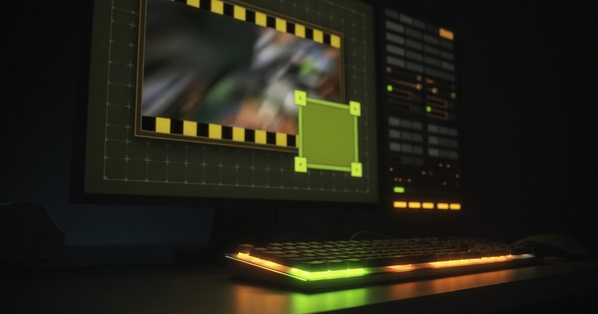

# FFmpeg Watermark Placement

Local static page that previews a still video frame and an image watermark, then copies an FFmpeg `-filter_complex` string plus a libx264 command.

It does **not** run FFmpeg, upload files, or need npm.

**Use it:** [a5ah1.github.io/ffmpeg-watermark](https://a5ah1.github.io/ffmpeg-watermark/)



## Open

From the repo root:

```
python -m http.server 8080
```

Then visit `http://127.0.0.1:8080/`.

`file://` also works (the scripts are classic `<script src>`, not ES modules). Copy falls back to `document.execCommand` when the Clipboard API is unavailable.

## Use

1. Drop a **frame still** onto the empty stage (or choose it in the form). Your video must match that W×H. Small frames stay native-size on the stage; **Fit** in the bar under the preview expands them for this visit only.
2. Drop a **watermark** (PNG preferred for alpha). JPEG, WebP, and static GIF are accepted. SVG, BMP, and video files are rejected.
3. Drag the logo, resize from a corner (aspect locked), or use the 3×3 presets. X/Y are source pixels.
4. Set opacity (default 80%) and, if needed, a blend mode. Preview blend is CSS and is not pixel-identical to FFmpeg.
5. Optionally fill video/output paths and open **Encode settings**.
6. Copy the **filter graph**, or the full command, and run it in a shell.

The frame file name is a label only. The watermark field is the second `-i` — paste a full path there if you want it in the command. The first `-i` is the separate video-input field.

**Help** and **About** are in the form header. **Reset** clears this tab after a confirm dialog. The tab remembers fields (and images when they fit) in session storage until you close the tab or reset.

## Example

```
ffmpeg -i "INPUT_VIDEO" -i "logo.png" -filter_complex "[1:v]scale=240:80,format=rgba,colorchannelmixer=aa=0.8[wm];[0:v][wm]overlay=x=1680:y=980:format=auto" -c:v libx264 -crf 23 -preset medium -pix_fmt yuv420p -c:a copy "OUTPUT"
```

Do **not** add CLI `-loop 1` or CLI `-shortest`. A still second input is held for the whole video by overlay `repeatlast=1`.

Encode flags, blend-mode caveats, GIF notes, tests, and debug query params are in [docs/notes.md](docs/notes.md).

## Develop

- [DESIGN.md](DESIGN.md) — v1 contract (goldens, module surface, UI ids)
- [AGENTS.md](AGENTS.md) — implementer notes and landmines
- [docs/notes.md](docs/notes.md) — command details and smoke tests
- `js/ffmpeg.test.html` — open it the same way as the app; every row should read PASS

## License

[MIT](LICENSE)
